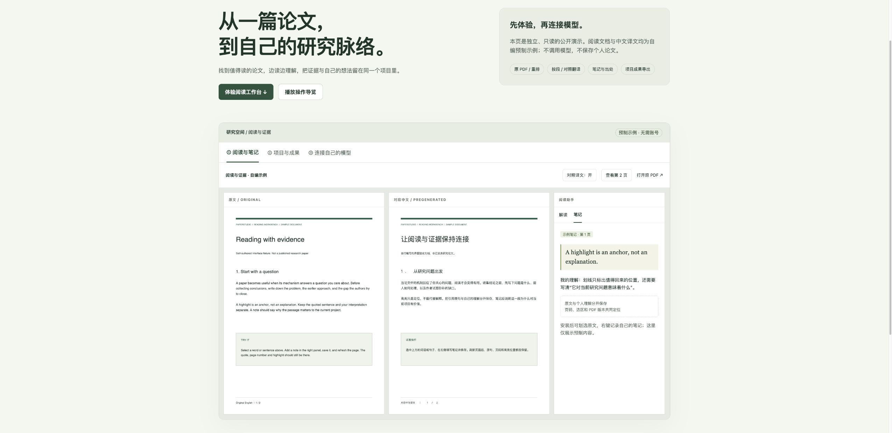

# PaperStudio

**从发现论文，到双语阅读，再到自己的研究项目。**

[English](README.en.md) · [交互演示](https://linchunhui.github.io/PaperStudio/) · [安装与升级](docs/deployment.md) · [版本下载](https://github.com/Linchunhui/PaperStudio/releases) · [反馈](https://github.com/Linchunhui/PaperStudio/issues)

[](https://github.com/Linchunhui/PaperStudio/actions/workflows/ci.yml)
[](LICENSE)

PaperStudio 是可自部署的论文研究工作台。把 arXiv 链接或 PDF 加入自己的项目，在原文旁做笔记、按需翻译和提问，把有出处的理解积累成可带走的成果。

适合持续跟进一个研究方向的个人和小组。**不配置模型，也能阅读、做笔记、整理项目和导出。** AI 功能使用你自己的兼容 API、本地模型或可选 Codex。

[](https://linchunhui.github.io/PaperStudio/)

## 先看看

[打开只读交互演示 →](https://linchunhui.github.io/PaperStudio/)

演示包含原文与预制译文、笔记、研究项目模板和一分钟操作导览，无需账号，不接收 API Key。文档为自编示例，便于了解交互；真实阅读和 AI 任务需运行完整工作台。也可从 [Release](https://github.com/Linchunhui/PaperStudio/releases) 下载 `paperstudio-demo.zip`，或启动服务后访问 `/demo/`。

## 可以做什么

| 工作 | 目前支持 |
| --- | --- |
| 找到值得读的论文 | HF / arXiv、可配置全网搜索、机构和会议索引、带来源与理由的推荐 |
| 导入与整理 | 链接 / PDF、按需后台下载与解析、多级项目、个人阅读进度 |
| 阅读原文 | 连续滚动的原 PDF、重排阅读、可选择文字、原页图表与公式 |
| 理解与翻译 | 默认不翻译；选段翻译、逐段双语、逐页就绪的 PDF 对照翻译 |
| 记录与研究 | 划词句做笔记、引用定位、摘要/粗读、笔记总结、项目问答与论文对比 |
| 迁移与分享 | BibTeX / RIS / Zotero CSV 文献清单导入；Markdown、HTML、JSON、BibTeX 成果导出 |
| 与小组积累 | 邀请制账号、项目共享、只读/编辑权限、个人笔记默认私有 |

搜索服务、模型和 BabelDOC 都是可选组件。[查看各功能的依赖和边界](docs/features.md)。相似论文网络不等同于引文网络；自动分类和生成摘要保留来源，不冒充人工核实。

## 快速开始

### Docker：无需克隆或本地构建

需要 Docker Engine / Docker Desktop 和 Compose v2。当前发布镜像为 Linux amd64；其他架构可先从源码构建。

```bash
mkdir paperstudio
cd paperstudio
curl -fL https://github.com/Linchunhui/PaperStudio/releases/download/v0.5.0/compose.release.yaml -o compose.yaml
docker compose up -d
docker compose exec paperstudio cat /data/bootstrap-token
```

打开 [http://127.0.0.1:8000](http://127.0.0.1:8000)，使用最后一条命令输出的一次性令牌创建管理员。令牌用完即删除，没有默认密码。

1. 点击 **打开阅读示例**，或导入自己的 PDF。
2. 选中一句原文，右键 → **笔记**，保存自己的理解。
3. 在 **我的论文库 → 迁入与导出** 创建研究模板、迁入文献或导出成果。
4. 需要 AI 时，到 **Skill 与配置 → 连接阅读模型** 保存配置，先测试连接，再测试实际调用。

默认镜像不包含完整历史目录和 Codex，数据保存在命名卷中。管理员可在设置页加载完整目录；也可选择 `0.5.0-full` 或 `0.5.0-codex` 镜像。镜像和版本下载以绿色 CI 对应的 [Release](https://github.com/Linchunhui/PaperStudio/releases) 为准；尚未发布时使用下方源码方式。

### 从源码运行

需要 Python 3.12；开发检查另需 Node.js 22。

```bash
git clone --depth 1 https://github.com/Linchunhui/PaperStudio.git
cd PaperStudio
python3.12 -m venv .venv
.venv/bin/python -m pip install -r requirements.txt
cp .env.example .env
./scripts/start.sh --no-demo
```

在另一个终端执行 `cat data/bootstrap-token`，然后创建管理员。Windows 使用 `.venv\Scripts\python.exe run.py --no-demo`。

源码保留完整目录，首次载入需要一些时间。希望先进入阅读界面，可在 `.env` 设置 `PAPERSTUDIO_CATALOG_MODE=light`，之后从设置页加载；不会删除已入库数据。

## 模型自由选择，状态分开确认

- **先不配置**：PDF、项目、笔记、文献导入和导出直接可用。
- **兼容 API**：填写基地址、模型 ID、API Key。按实际服务支持的模型填写。
- **本地模型**：例如 Ollama / LM Studio 提供的兼容接口；Docker 内连接宿主机可用 `host.docker.internal`。
- **Codex CLI**：可选镜像中安装 CLI，服务操作者另行登录。阅读工作台不会接收你的 Codex 登录凭据。

密钥只保存于服务端。实际调用测试会发送一条短消息，可能产生少量费用；没有接通时明确报错。PDF 版式翻译另需可选 BabelDOC，连接测试不能代替翻译质量验收。[模型与解析说明](docs/model-and-parsing.md)

## 完整数据与自己的资料

原有目录、关系和阅读卡片分片全部保留，可选数据包逐文件验证 SHA256。目录包含 HF 周榜、重点机构与会议来源，具体覆盖日期、待核验记录和数量见 [数据说明](DATA_NOTICE.md)；不是实时全网全集。

论文、笔记、模型设置和任务数据保存在自己的服务中。调用外部模型、搜索或下载论文时，对应内容会发往所选服务。没有自动上传个人文献库或默认遥测。

成果导出默认只包含自己的笔记；共享笔记和 AI 成果需要主动勾选。文献清单导入先预览，不会自动下载附件或调用模型。成果 ZIP 方便迁移内容；**完整恢复仍须备份整个数据目录**。

## 开发与贡献

```bash
.venv/bin/python -m pip install -r requirements-dev.txt
./scripts/check.sh
```

CI 运行后端与前端回归、真实 Chromium 操作、容器启动和重启、完整数据包校验。通过后发布带提交号和版本号的镜像。AI 单测使用受控响应，不宣称所有模型都已通过真实质量测试。

欢迎提交可复现的 Bug、翻译/解析适配、来源连接器和文档改进。请先看 [贡献指南](CONTRIBUTING.md)、[路线图](ROADMAP.md) 和 [安全反馈](SECURITY.md)。如果它帮你完成了一次阅读或整理，欢迎 Star，也欢迎在 Issue 分享实际用法和遇到的障碍。

[完整工作台说明](docs/workbench-guide.md) · [API 与数据约定](docs/contract.md) · [更新记录](CHANGELOG.md)

## 许可证

PaperStudio 原创代码按 **AGPL-3.0-only** 发布，见 [LICENSE](LICENSE)。第三方依赖保留各自许可，见 [THIRD_PARTY_NOTICES](THIRD_PARTY_NOTICES.md)；第三方论文、摘要和来源数据不因本仓库代码许可而改变权利归属，见 [DATA_NOTICE](DATA_NOTICE.md)。
